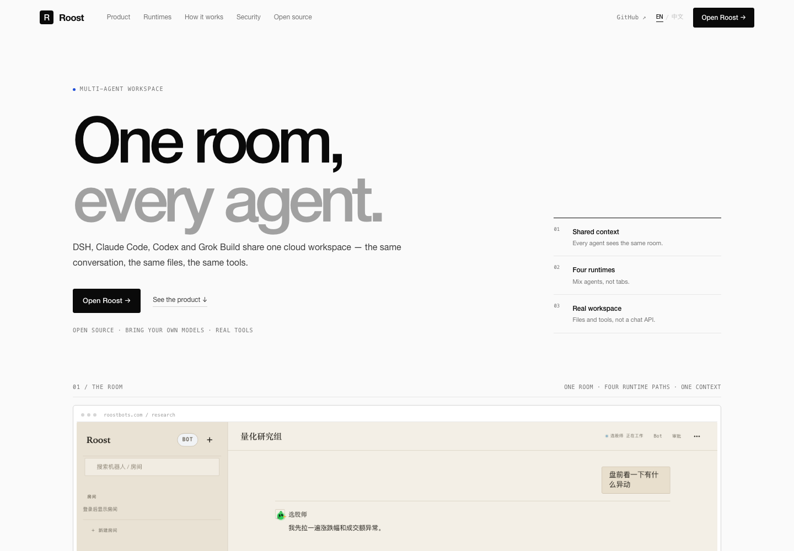

# Roost Bot

一群住在云机器上的 Bot，在同一个房间里协作；底层可以跑 DSH、Claude Code、Codex、Grok Build 等不同 Agent Runtime。

- **多 Agent 房间**：一个房间多个 Bot，按轮次发言、互相 @、流式输出
- **异构 Runtime**：DSH、Claude Code、Codex、Grok Build（ACP）；Hermes 已有 ACP 适配
- **Docker 运行时**：控制面签发运行 token，Docker worker 为每个 workspace 拉起独立容器
- **BYO 模型**：DeepSeek、Anthropic、OpenAI、xAI 等用自己的 key；平台不转售推理
- **Web / 桌面**：同源网页、桌面端、账号登录、SSE 实时消息

截图：[房间](docs/assets/ui-desk-room.png) · [Bot 列表](docs/assets/ui-desk-bots.png) · [设置](docs/assets/ui-desk-settings.png)

## 现在是什么状态

```text
✅ 控制面 + 网页 + SQLite 单机闭环
✅ 多 Agent 房间 / 私聊 Bot / harness 头像 / Bot 交接对话 / 轮次 / 流式输出 / 审批
✅ RuntimeProvider 抽象
✅ Docker runtime（worker + workspace 容器）
✅ Claude Code / Codex / DSH / Grok Build 真实模型调用
✅ bridge 网络 + egress allowlist
✅ per-Bot credentialRef
✅ Native Relay PoC
✅ 1339 tests pass
```

远端真实环境验证过：

```text
ClaudeBot  → CLAUDE_DEEPSEEK_OK
CodexBot   → CODEX_DEEPSEEK_OK
DshBot     → DSH_DEEPSEEK_OK
GrokBot    → GROK_DEEPSEEK_ROOM_OK
```

四个 Bot 在同一个远程 Docker workspace 里回复，模型都是 DeepSeek。

## 架构

```text
Browser / Desktop / IM
        │ REST + SSE
        ▼
┌──────────────────────────┐
│ Control Plane            │
│ Node 22 / SQLite         │
│ rooms · bots · rounds    │
│ auth · budgets · memory  │
└──────────┬───────────────┘
           │ RuntimeProvider
     ┌─────┴──────────┐
     ▼                ▼
 local runtime    Docker worker
 (spawn room-agent) (HTTP + token)
                      │ docker run
                      ▼
                ┌────────────────────┐
                │ workspace container │
                │ room-agent         │
                │ ├─ DSH             │
                │ ├─ Claude Code     │
                │ ├─ Codex ACP       │
                │ └─ Grok Build ACP  │
                └────────────────────┘
```

设计文档：

- [RuntimeProvider / AgentAdapter 边界](docs/design/runtime-providers.md)
- [Docker runtime 方案](docs/design/docker-runtime.md)
- [实施状态与剩余工作](docs/design/docker-runtime-roadmap.md)
- [Grok Build 本地 + DeepSeek](docs/design/grok-build-local.md)

## Runtime Providers

控制面只依赖 `RuntimeProvider`，计算层可替换：

| Provider | 生命周期 | 持久 workspace | 状态 |
|---|---|---|---|
| `docker` | Docker worker + `roost-ws-<hash>` 容器 | 宿主机 bind mount | ✅ 生产默认 |
| `local` | 本机 `room-agent` 子进程 | 本地目录 | ✅ 开发/本机 |
| `daytona` | Daytona sandbox + volume | Daytona Volume（FUSE/S3） | ✅ Provider + 契约测试 |
| `kubernetes` | Pod + PVC | PVC | ✅ Provider + 契约测试 |
| `openshell` | 旧 OpenShell supervisor | 卷 | ⛔ 已封存，仅显式恢复 |

选择方式：

```sh
ROOST_RUNTIME_PROVIDER=docker
# 或 daytona / kubernetes / local
```

### Daytona

```sh
ROOST_RUNTIME_PROVIDER=daytona
DAYTONA_API_KEY=...
DAYTONA_SNAPSHOT=roost-agent:latest   # 从 roost/agent 镜像构建的 snapshot
DAYTONA_VOLUME=roost-workspaces       # 可选
ROOST_CP_HOST=<Daytona 能访问的控制面地址>
ROOST_CP_PORT=8787
```

Daytona sandbox 由 snapshot entrypoint 启动 `node /opt/roost/room-agent.mjs`。
详见 [daytona-kubernetes.md](docs/design/daytona-kubernetes.md)。

### Kubernetes

```sh
ROOST_RUNTIME_PROVIDER=kubernetes
ROOST_K8S_API_URL=https://kubernetes.default.svc
ROOST_K8S_NAMESPACE=roost
ROOST_K8S_IMAGE=ghcr.io/<org>/roost-agent:latest
ROOST_K8S_STORAGE_CLASS=standard
ROOST_CP_HOST=<Pod 能访问的控制面地址>
ROOST_CP_PORT=8787
```

每个 workspace 一个 PVC + 一个长活 Pod；Pod 的 readinessProbe 检查
`/workspace/.roost/ready`。`stop` 删除 Pod、保留 PVC。

## 本地电脑（Computer / roostd）

把本地电脑接入 workspace，让某个 Bot 在本机运行：

```sh
# 在 Web 设置页生成 CLI 令牌
roost login --token <cli-token> --server https://roostbots.com
roost setup
roost project add ./project --label project-a
roost bind <workspace-id> --bot <bot-id> --agent claude-code --project <project-id>
roost agent discover
roost daemon autostart enable
roost daemon start
```

本地 Agent 也可通过 MCP 使用 Roost 的绑定/检查工具：

```json
{"mcpServers":{"roost":{"command":"roost","args":["mcp","serve"]}}}
```

也可以在 Web 设置页「电脑与绑定」里直接选择电脑 / 项目 / Bot / Agent 绑定。

之后房间里的这个 Bot 会把轮次派给本地 `roostd`，在本机目录启动 Agent，
结果回到房间。本地路径只保存在 `~/.roost`，不上传云端。

设计：[local-computer.md](docs/design/local-computer.md)

## 支持的 Runtime

| Runtime | 接入方式 | 模型来源 | 状态 |
|---|---|---|---|
| **DSH** | SDK 长活进程 | 控制面代理 / 用户 BYO | ✅ 默认 |
| **Claude Code** | CLI stream-json | Anthropic 兼容端点（DeepSeek 可） | ✅ |
| **Codex** | ACP (codex-acp) | OpenAI 兼容端点（DeepSeek 可） | ✅ |
| **Grok Build** | ACP (`grok agent --always-approve stdio`) | 自定义 OpenAI 兼容端点（DeepSeek 可） | ✅ |
| **Hermes** | ACP (`hermes acp`) | DeepSeek / OpenAI 兼容 | ✅ 已适配，暂未接入生产 |
| **Native Relay** | 外部会话轮询 room assignment | 用户环境自己的模型 | PoC |

镜像内置：

```text
DSH            0.2.1-rc.5
Claude Code    2.1.319
Codex CLI      0.167.0
Grok Build     1.0.77
Hermes Agent   0.19.0
```

## 快速开始（本地控制面）

要求 Node ≥ 22.18，零依赖，不需要构建。

```sh
git clone https://github.com/JingxuanC/roostbot
cd roostbot

ROOST_DB=/tmp/roost.db \
  node --experimental-strip-types apps/api/src/main.ts
```

打开 <http://127.0.0.1:8787/>。第一次打开是登录页；注册/登录后进入房间。当前是纯云端模式，没有本地配对页。


## Docker Runtime

一个 workspace 一个长期容器，容器里跑 room-agent 和多个 Agent harness。

### 1. 构建镜像

```sh
docker build --network host \
  -f apps/runtime/agent.Dockerfile \
  -t roost/agent:multi-runtime .
```

镜像包含 DSH、Claude Code、Codex、Grok Build、Hermes，以及 DeepSeek 配置模板。

### 2. 部署 Docker worker

在 Docker 宿主机：

```sh
sh scripts/install-docker-worker.sh
```

配置样例：

- [deploy/docker-worker.env.example](deploy/docker-worker.env.example)
- [deploy/roost-docker-worker.service](deploy/roost-docker-worker.service)

### 3. 配置控制面

```bash
ROOST_RUNTIME_PROVIDER=docker
ROOST_DOCKER_WORKER_URL=http://172.17.43.58:8790
ROOST_DOCKER_WORKER_TOKEN=...
ROOST_DOCKER_IMAGE=roost/agent:multi-runtime
ROOST_CP_HOST=172.17.43.89
ROOST_CP_PORT=8787
ROOST_CP_SCHEME=http
ROOST_BOT_CREDENTIALS_FILE=/etc/roost/bot-credentials.json
```

完整样例：[deploy/roost-api-docker.env.example](deploy/roost-api-docker.env.example)。

### 4. 网络与安全

当前默认：

```text
非 root uid 1000
cap-drop ALL
no-new-privileges
memory / pids / cpu limit
独立 bridge 网络 roost-ws
egress 默认拒绝
  · 放行控制面 :8787
  · 放行 api.deepseek.com:443
```

egress allowlist：[deploy/roost-egress-allowlist.sh](deploy/roost-egress-allowlist.sh)；
Prometheus 规则：[deploy/prometheus-roost-rules.yml](deploy/prometheus-roost-rules.yml)。

### 5. 验证

```sh
sh scripts/verify.sh
```

或只跑测试：

```sh
node --experimental-strip-types --test \
  "packages/*/test/*.test.ts" "apps/*/test/*.test.ts"
```

## 模型与凭据

工作区模型 key 存在控制面（SQLite，加密）；Bot 级凭据通过 `credentialRef` 引用：

```json
{
  "vault://claude-a": { "ANTHROPIC_API_KEY": "sk-..." },
  "vault://codex-b": { "OPENAI_API_KEY": "sk-..." },
  "vault://grok-c": { "DEEPSEEK_API_KEY": "sk-..." }
}
```

```bash
ROOST_BOT_CREDENTIALS_FILE=/etc/roost/bot-credentials.json
```

Grok Build 本地配 DeepSeek：

```sh
sh scripts/configure-grok-deepseek.sh
grok -p '只回复 OK' --model deepseek-chat
```

详见 [Grok Build 本地 + DeepSeek](docs/design/grok-build-local.md)。

## 目录

```text
apps/api/            控制面 API、房间、审批、运行时管理
apps/web/            同源网页
apps/runtime/        room-agent、Agent adapters、Docker worker、镜像 Dockerfile
packages/            store / rooms / agent-runtime / sandbox / contract ...
scripts/             本地 E2E、Docker worker 安装、Grok 配置、验收
deploy/              systemd、nginx、worker、egress、Prometheus
docs/design/         40 份设计文档
docs/build/          验收证据
```

## 官网

官方站点在 `apps/site/`，已部署在 <https://www.roostbots.com/>；零构建、零外部请求、中英文切换：

```bash
node scripts/serve-site.mjs        # http://127.0.0.1:4173
```



欧美极简、中性黑白灰、无衬线排版；支持 EN / 中文切换（右上角，或 `?lang=en`）。
设计参考 Linear 的克制、Vercel 的产品即主角、Anthropic 的安静和 Raycast 的细节。

## 文档

| 文档 | 内容 |
|---|---|
| [docs/vision.md](docs/vision.md) | 做什么、不做什么 |
| [docs/architecture.md](docs/architecture.md) | 控制面 / 运行时 / 沙箱 / 租户 |
| [docs/runtime-contract.md](docs/runtime-contract.md) | DSH 作为云运行时的契约 |
| [docs/design/README.md](docs/design/README.md) | 设计文档索引 |
| [docs/design/docker-runtime-roadmap.md](docs/design/docker-runtime-roadmap.md) | Docker runtime 完成度与剩余项 |
| [docs/design/native-relay.md](docs/design/native-relay.md) | Native Relay PoC |
| [deploy/README.md](deploy/README.md) | 部署、反代、备份恢复 |

## 已知限制

```text
单机控制面，没有 HA
没有旧 OpenShell workspace 数据迁移
read-only rootfs 默认关闭（DSH native addon 兼容问题）
gVisor / Kata 只完成评估，未切换默认运行时
多 Docker worker 已有确定性放置，但只部署了一台
Prometheus / Alertmanager 规则已写，实例未部署
Hermes 已适配但暂未接入生产
```

## 许可

Apache License 2.0，见 [LICENSE](LICENSE) 与 [NOTICE](NOTICE)。

第三方组件登记在 [THIRD_PARTY_NOTICES.md](THIRD_PARTY_NOTICES.md)。
