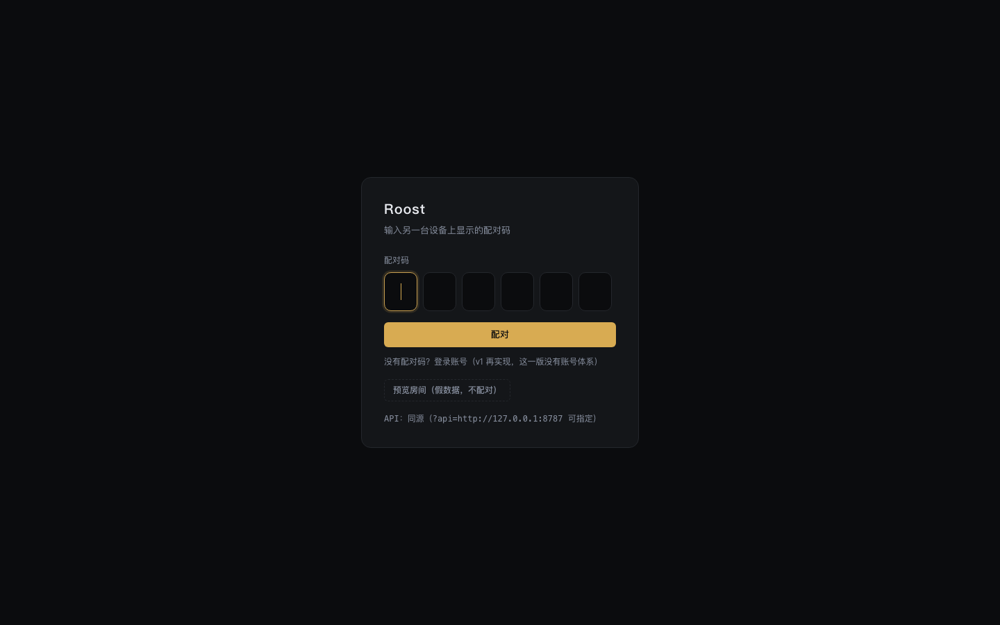
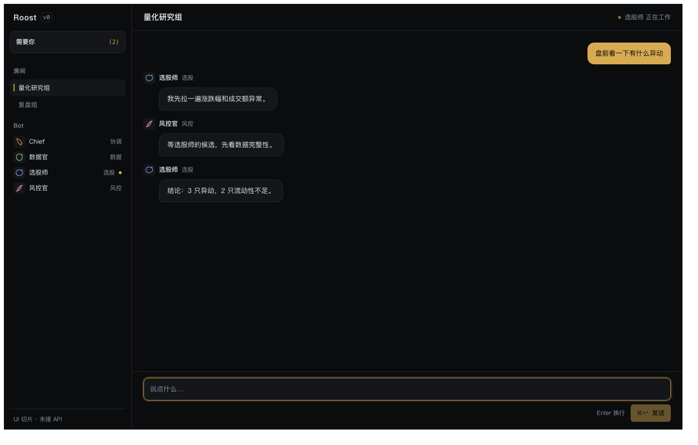
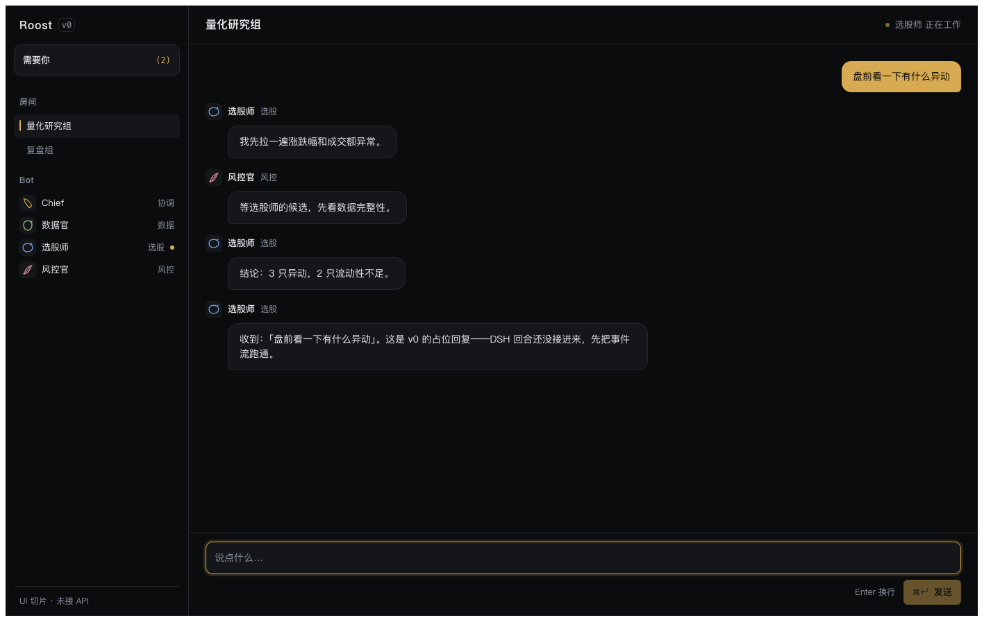

# Roost Bot

一群住在云机器上的 Bot，能连回你自己电脑上的 DSH。

- **云机器**：常驻、随时可用，Bot 团队在云上值班
- **本地 DSH**：配对一次，云上的 Bot 就能使用你本机的工具、文件和模型额度
- **记忆**：由 [causal-memory](../causal-memory) 提供，不是聊天记录，是可检索、可追溯的判断
- **模型**：用户自带 token（BYO），平台不转售推理

状态：**M4 已完成**（Bot 域、DM+群 kickoff、Bot 建群+审批、成员/responder、轮次引擎与轮内 stop、内部接口、前端五视图）。剩远端真实模型/浏览器全流程，进度见 [TODO.md](TODO.md)。

## 文档

| 文档 | 内容 |
|---|---|
| [TODO.md](TODO.md) | **唯一任务清单**（进度：`node scripts/todo-stats.mjs`） |
| [docs/vision.md](docs/vision.md) | 做什么、不做什么、为谁做 |
| [docs/architecture.md](docs/architecture.md) | 控制面 / 运行时 / 沙箱 / 租户模型 |
| [docs/runtime-contract.md](docs/runtime-contract.md) | DSH 作为云运行时必须提供的七条契约 |
| [docs/design/](docs/design/) | 设计文档（19 份）：事件、认证、记忆、预算、loop 与上下文、消息、协作、调度、工作区、沙箱、连接器、存储、界面、插件、产物、Bot 图标、房间运行时、Bot 身份、插件市场 |
| [docs/spikes/](docs/spikes/) | 可复现的实验与结论（含环境限制） |
| [docs/decisions/](docs/decisions/) | 命名、记忆、许可、插件面板等决策记录 |

## 许可

Apache License 2.0，见 [LICENSE](LICENSE) 与 [NOTICE](NOTICE)。

第三方组件登记在 [THIRD_PARTY_NOTICES.md](THIRD_PARTY_NOTICES.md)。
## 跑起来（M2 切片）

零依赖、无需构建；Node ≥ 22.18（用内置 `node:sqlite` 与类型擦除）。

```sh
git clone https://github.com/JingxuanC/roostbot && cd roostbot
ROOST_DB=/tmp/roost.db node --experimental-strip-types apps/api/src/main.ts
# 打开 http://127.0.0.1:8787/ ，配对页就是同源网页
```

控制面同时伺服网页；配对 → 房间（房间目前是假数据）。验收脚本：

```sh
sh scripts/verify.sh      # 108 个测试 + 配对/房间/消息/Bot 回合 的真实 HTTP 检查
```

想看 Bot 回话，再起一个 worker（另一个终端）：

```sh
ROOST_RUNTIME_TOKEN=dev-token node --experimental-strip-types apps/runtime/worker.ts
# worker 用 ROOST_API（默认 127.0.0.1:8787）和 ROOST_BOT_ID（默认 selector）连控制面
```

想直接看有内容的房间（不手动发消息）：

```sh
node --experimental-strip-types scripts/seed-demo.ts /tmp/roost.db   # 种一个 workspace + 房间 + 4 条消息
ROOST_DB=/tmp/roost.db node --experimental-strip-types apps/api/src/main.ts
```



**真实房间**（消息来自控制面 SQLite；空房间会自动建一个）：



**Bot 真的在房间里说话**（worker 订阅事件、以 Bot 身份写回；v0 是占位回复，接口已经固定）：



**这一版有什么/没有什么**（诚实清单）：

| 有了 | 还没有 |
|---|---|
| 事件日志 + 幂等 + 迁移（SQLite） | 多端同步（同一 workspace 两个窗口还没一起测） |
| 控制面：配对、会话、workspace | DSH 真跑在容器里（只有 sidecar 与镜像声明） |
| 房间/消息的真实接口 + SSE 推送 | 多端同步（同一 workspace 两个窗口还没一起测） |
| **Bot 真的在房间里说话**（worker + 占位回复 + 幂等 + 不自激） | 回复是**模板**不是模型（DSH 回合还没接） |
| 网页：配对页 + 真实房间（SSE）+ Bot 回复 + 程序化图标 | 投递方式、流式 token、审批、连接器、插件页 |
| sidecar 测试、entrypoint 优雅停机 | Docker 构建未在这台机器验证 |
| 沙箱策略模型 + OpenShell 后端 | 真沙箱已在远端验证（需 Docker ≥ 28，见 spike 0002） |
| **worker 的回复 = 沙箱里的真实 DSH 回合**（DeepSeek，凭据由 OpenShell 注入） | 单机部署；没有多租户/账号体系 |
| 网页端真实房间 + SSE 多端 + Markdown 渲染（截图 `docs/assets/m5-live-room.png`） | 沙箱空闲只能 stop/start（docker 驱动不支持 suspend） |

