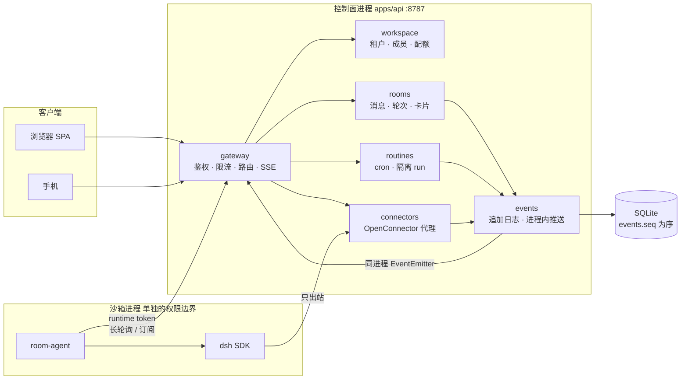
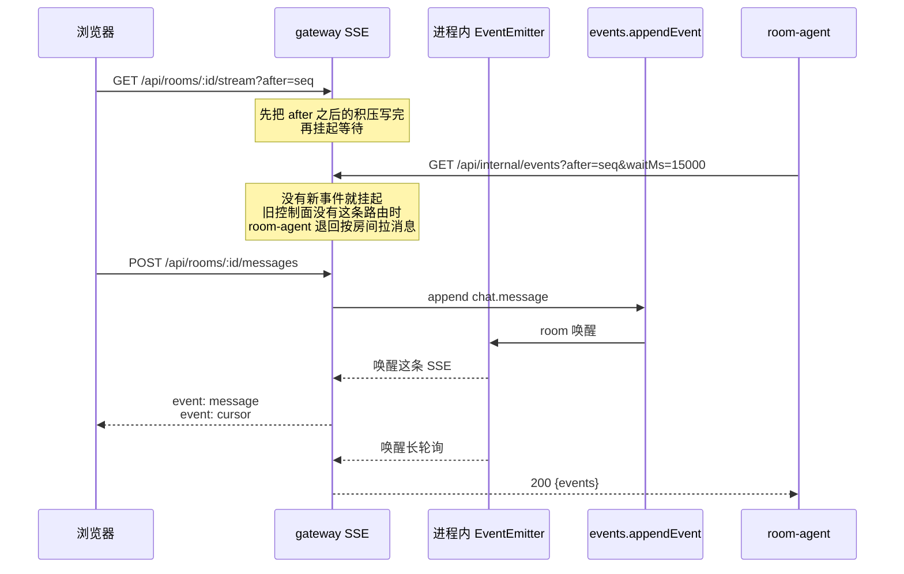
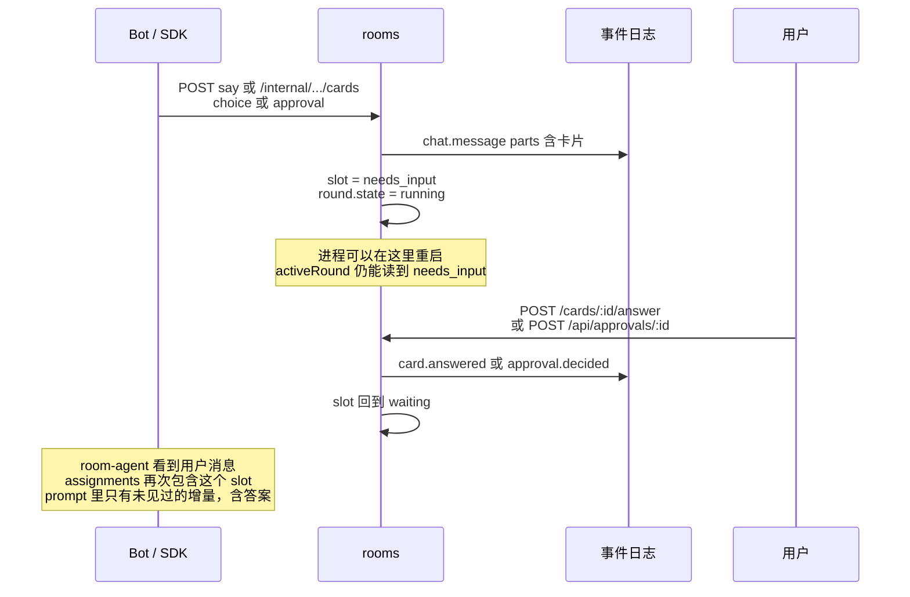
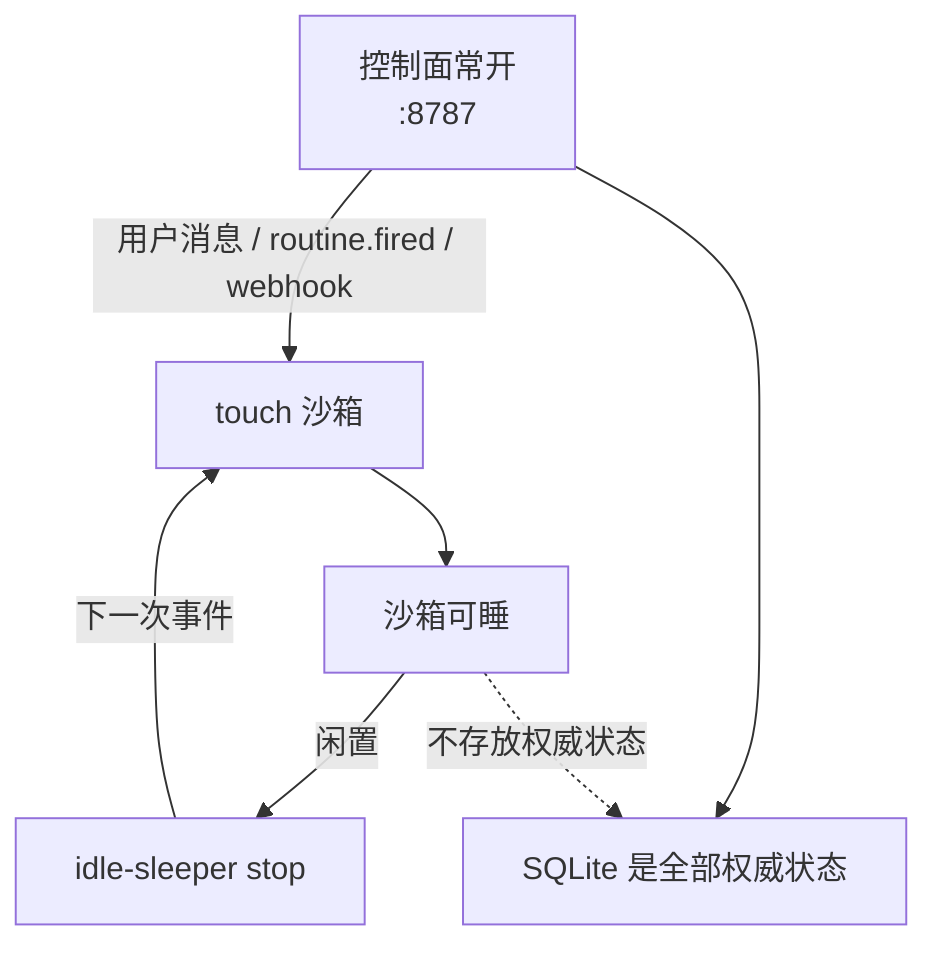
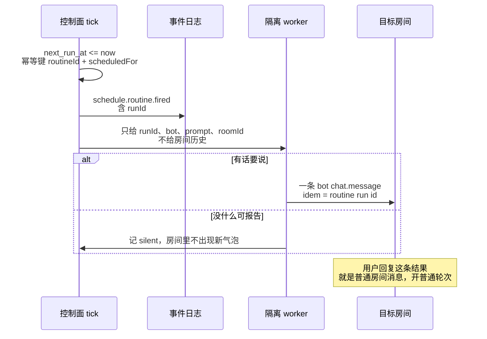

# 架构 v2：模块化单体、房间事件流、可恢复的轮次

> 状态：设计（2026-11-06）。本文是控制面下一阶段的上位文档。
> 它不推翻 [events.md](events.md)、[rooms.md](rooms.md)、[scheduling.md](scheduling.md)、[sandboxing.md](sandboxing.md)、[connectors.md](connectors.md)。
> 那些文档仍然定义各域语义；本文规定**模块边界、事件怎么推、轮次怎么停车再开走、定时任务怎么进房间**。
>
> 对照实现时以仓库代码为准。下面「现状」一节核对过 `092f737`：消息就是 `events` 表里的 `chat.message`，`seq` 全局单调；浏览器 SSE 与 room-agent 都在轮询读库；写侧没有广播。

## 1. 要解决的问题

现在一条用户消息的路径是：

```text
POST /api/rooms/:id/messages
  → appendEvent(chat.message)
  → openRound
  → 浏览器每 ~700ms 读库（SSE）
  → room-agent 每 ~500ms GET /internal/.../messages?after=
  → DSH 回合
  → advance 再写一条 chat.message
  → 下一拍 SSE 才看见
```

这能工作，但有四件事情做不到：

1. **写完不能立刻推**。SSE 和沙箱都在空转轮询，延迟被轮询间隔卡住。
2. **房间时间线只有纯文本**。图片要用户从 composer 发出、选项卡、审批卡，都还不是消息的一部分。审批活在自己的表和 `#/approvals`，不进房间 seq。
3. **等人的轮次没有「停在日志里、重启后续上」的契约**。审批靠沙箱内 DSH 桥轮询；选项卡没有落点。进程重启后，靠的是轮次表碰巧还在，不是事件。
4. **定时任务和房间是两条线**。`workspace_schedules` 能 tick 出 activation/run，但不会把「只带 prompt、不带整段聊天记录」的结果写回目标房间。

v2 的做法：继续是一个进程里的模块化单体，外加一个权限更低的沙箱进程。模块之间只走公开函数和房间事件流，不读别人的表。事件流先用现有 SQLite `seq`，推送用进程内订阅。以后要拆服务，换的是传输，不是表。

## 2. 非目标

- 不在这一阶段把控制面拆成多个部署单元。
- 不把消息放进 etcd。etcd 如果以后出现，只用于选主、租约、成员发现，不承载聊天。
- 不更换 DSH，不把模型调用搬进控制面。
- 不改现有审批状态机（`pending → approved|rejected`，不翻案）。
- 不让定时任务伪装成用户消息（那会按 [rooms.md](rooms.md) 再开一轮、叫醒所有人）。
- 运行时保持零依赖。Node.js `>=22.18` 自带的 `node:sqlite`、`node:events`、`node:http` 就够。

## 3. 目标形态



控制面**始终在线**。沙箱可以睡。把沙箱叫醒的是事件：用户消息、`routine.fired`、连接器 webhook。沙箱里不存放权威状态；房间日志、轮次、审批、routine 都在控制面的 SQLite。

本地 DSH（用户自己机器上的出站节点）仍然是「够得着本机文件和工具」的那条通道，见 [docs/architecture.md](../architecture.md)。云上迁移是把同一个沙箱契约接到云端 DSH，控制面不因此改事件形状。现在的部署依赖本机 OpenShell / DSH 进程；v2 不假装这个依赖已经消失。

## 4. 模块边界

每个模块有自己的公开入口。别的模块可以调用这些函数，或者订阅事件。**禁止** `JOIN` 别人的表、直接 `prepare` 别人的 SQL。需要数据时，要么走对方的读函数，要么读事件投影。

| 模块 | 现在落在哪 | 公开入口 | 拥有的状态 | 不做什么 |
|---|---|---|---|---|
| gateway | `apps/api/src/server.ts` 的路由、鉴权、限流、SSE | HTTP 路由表；`subscribeRoom(roomId, afterSeq)` | 连接、令牌桶。不落业务行 | 不写消息、不决定谁发言 |
| workspace | `packages/store` 的 workspace / members / budget | `requireMember`、配额检查 | `workspaces`、`workspace_members`、配额 | 不解释聊天 payload |
| events | `packages/store/src/events.ts` + 进程内总线 | `appendEvent`、`readEvents`、`subscribe` | `events` 表、`seq` | 不理解轮次，只保证顺序和幂等 |
| rooms | `packages/store/src/rooms.ts`、`rounds.ts`、`apps/api` 的 round-orchestrator | `sendMessage`、`openRound`、`answerCard`、`advance` | `rooms`、`room_rounds`、`room_seen` | 不自己算 cron，不保管第三方 token |
| sandbox | `apps/runtime`（另一个进程） | runtime token 下的内部 HTTP | 沙箱内的 DSH 会话。权威状态不在这里 | 不写别的租户；不持有用户会话 cookie |
| routines | 新的 `routines` 表 + 调度 tick | CRUD、`tickRoutines`、`completeRoutineRun` | routine 定义、隔离 run | 不把整段房间日志塞进 run |
| connectors | `packages/connectors` + `deploy/openconnector-bridge.mjs` | `GatewayBackend.call` | 授权与调用审计 | token 不进沙箱；不直接改房间表 |

拆服务的预留方式：gateway 已经是唯一的外网入口。以后 rooms 或 routines 要独立进程，就改成「订阅事件流 + 调用对方的 HTTP」，调用方代码不动 SQL。

### 4.1 gateway

四件事，都已经有雏形，v2 把它们收成一层：

1. **鉴权**。用户走会话（Bearer、cookie、`?access_token=` 只给不能设头的 EventSource）。沙箱走 runtime token，workspace token 不能跨租户。
2. **按租户限流**。沿用现有令牌桶，键是账号或 workspace，不是全局一个桶。
3. **路由**。浏览器只看见 `/api/*`。沙箱只看见 `/api/internal/*` 和 `/api/rooms/:id/say`。
4. **SSE 长连接**。一条连接绑定一个房间、一个 `afterSeq`。有新事件就写帧；没有就挂起，直到总线唤醒或兜底超时。不再以 700ms 为周期读库。

### 4.2 sandbox 仍然是进程边界

`apps/runtime/room-agent.mjs` 继续跑在沙箱里，用 `x-runtime-token` 访问控制面。控制面不把 SQLite 文件挂进沙箱。沙箱挂了，控制面和已经落库的轮次都还在；沙箱起来后续读 `afterSeq`。

## 5. 事件流

### 5.1 物理形态：继续用现在的 `events.seq`

不新建第二张消息表。一条房间事实 = `events` 里的一行：

- `seq`：全库单调，断线续传的唯一游标。
- `audience`：`room:<roomId>` 的行构成这个房间的日志。`team` 仍然用于不进房间时间线的审计（现有审批事件保持 `audience='team'`）。
- `idem`：同键再写一次，返回旧行，不产生新 `seq`。
- 只追加。改消息用新事件，不 `UPDATE` 旧 payload。

房间日志的读法：

```text
readRoomEvents(roomId, afterSeq) =
  SELECT ... FROM events
  WHERE audience = 'room:' || roomId AND seq > afterSeq
  ORDER BY seq ASC
```

`chat.message` 仍然是「人能在气泡里看见的那一行」。其它 kind 是同一条日志上的信号，SSE 会推，但旧客户端只监听 `event: message`，会自然忽略它们。

### 5.2 事件种类

存储 kind 遵守 [events.md](events.md) 的 `domain.action`。SSE 的 `event:` 名是给客户端的短名。两者一一对应。

| 存储 kind | SSE `event:` | 什么时候写 | payload 要点 |
|---|---|---|---|
| `chat.message` | `message` | 用户、Bot、routine 结果 | `text`、`role`、可选 `parts[]` |
| `chat.message.delta` | `message.delta` | 流式增量 | `messageSeq` 或临时 id、`delta` |
| `chat.card.answered` | `card.answered` | 用户点了选项 | `cardId`、`optionId`、`label` |
| `approval.requested` | `approval.requested` | 房间里出现审批卡时**另写一条** `audience=room:…`。原有 `audience=team` 的行保持不动 | `approvalId` |
| `approval.decided` | `approval.decided` | 同上，决策后再投影一条进房间 | `approvalId`、`decision` |
| `turn.round.started` | `round.started`，并兼容旧的 `round` | 新开一轮 | 轮次快照 |
| `turn.round.ended` | `round.ended`，并兼容旧的 `round` | 一轮结束 | `roundId`、`state` |
| `turn.speaking` | `speaking` | 轮到某个 Bot | `botId`、`roundId` |
| `schedule.routine.fired` | `routine.fired` | cron 到点 | `routineId`、`runId`、`scheduledFor` |

消息部件 `parts[]` 放在 `chat.message` 的 payload 里，不每种部件一个 kind。文本字段 `text` 保留，旧客户端继续显示它。

```jsonc
{
  "type": "text" | "image" | "choice" | "approval" | "tool",
  // text
  "text": "口径请拍板。",
  // image：artifactId 必须已经属于这个 workspace
  "artifactId": "…",
  // choice
  "cardId": "crd_…",
  "prompt": "口径用 TTM 还是最近一期？",
  "options": [{ "id": "a", "label": "TTM（滚动十二个月）" }],
  // approval：approvalId 指向现有 approvals 表，决策仍走 POST /api/approvals/:id
  "approvalId": "apr_…",
  // tool
  "name": "get_quote",
  "summary": "600519"
}
```

### 5.3 和 AG-UI 对齐（只在便宜的地方）

[AG-UI](https://docs.ag-ui.com/concepts/events) 用另一套事件名描述「一轮 agent 交互」。我们不把存储信封换成 AG-UI，那会拆掉现有 `domain` / `kind` / `idem`。便宜的做法是：**落库用 roost 信封，出口投影一个 `agui` 对象**。旧客户端忽略 `agui`。

| roost | `agui.type` |
|---|---|
| `chat.message` | `TEXT_MESSAGE_CONTENT`（`messageId=msg_<seq>`，`delta` 为全文，`role` 为 `user` 或 `assistant`） |
| `chat.message.delta` | `TEXT_MESSAGE_CONTENT`（`delta` 为增量） |
| `turn.round.started` | `RUN_STARTED`（`threadId=roomId`，`runId=roundId`） |
| `turn.round.ended` | `RUN_FINISHED` |
| `turn.speaking` | `STEP_STARTED`（`stepName=botId`） |
| `parts[].type=tool` | `TOOL_CALL_START` |
| 选项 / 审批 | `CUSTOM`（`name` 为 `choice` 或 `approval`） |

### 5.4 推送，而不是 700ms 轮询



规则：

1. `appendEvent` 成功之后才通知总线。通知失败不影响写入（现有 `setEventSink` 已经是这个契约）。
2. SSE 先读后等。写入发生在「读完、还没开始等」的窗口里时，监听器要记住这次唤醒，避免干等到兜底超时。
3. 兜底超时仍然存在，默认 15 秒，测试可以把间隔调小。另一个进程写完 SQLite 后应立刻 `POST /api/internal/notify`（runtime token，body `{roomId, seq?}`）。这条路由不写事件，只敲本进程总线，SSE 和长轮询马上再读库，不用干等兜底。
4. 续传：`?after=` 与 `Last-Event-ID` 取较大者。`event: message` 的 JSON 形状保持 `{seq, at, actor, text, attachments}`，新字段只追加。
5. 沙箱侧优先 `GET /api/internal/events`。这是 workspace 范围的长轮询，避免「每个房间各挂一个 15 秒请求」串成队。404 表示对面还是旧控制面，room-agent 退回原来的按房间 `messages?after=`。

### 5.5 以后换成什么

| 阶段 | 传输 | 存储 |
|---|---|---|
| 现在 | 同进程 `EventEmitter` | SQLite `events.seq` |
| 多进程控制面 | Postgres `LISTEN/NOTIFY`，载荷只带 `seq`，内容仍回表读 | Postgres 上的同一张追加日志 |
| 多机 | NATS JetStream，subject `room.<roomId>`，消费者按 `seq` 确认 | 仍然是日志，不是 etcd |

**明确不用 etcd 传消息。** etcd 的数据模型是键值加租约，适合选主和成员列表，不适合按房间无限追加、按 `seq` 回放的聊天日志。

## 6. 可恢复的暂停

一轮在等选项或审批时，不能只活在沙箱内存里。停车点写在两处，重启后都能读到：

1. **日志**：`chat.message`（带 card part）已经追加。答案或决策再追加 `chat.card.answered` / 房间投影的 `approval.decided`。
2. **轮次投影**：对应 slot 的状态改为 `needs_input`，`slots_json` 里记下在等哪张卡（`awaiting: {kind, id}`）。`room_rounds.state` 保持 `running`。`finishRound` 把 `needs_input` 视为「还没结束」，这样不会在等人的时候把轮次收成 `done`。

现有的 `waiting-approval`（DSH 工具桥那条路）语义不变：那是 slot 结果，不是这张房间卡片。



答案接口：

- `POST /api/rooms/:roomId/cards/:cardId/answer`，body `{optionId}`。
- 必须是这个房间的成员。卡不在这个房间里，就 404，不泄露别的租户有没有这张卡。
- 同一个选项再点一次：幂等，返回已有答案。
- 同时追加一条用户 `chat.message`（文本是选项文案），这样时间线上看得到人的选择，room-agent 也会把它当成用户消息继续。

审批卡：

- 创建时走现有 `approvals` 表和 `createApproval`。`POST /api/approvals/:id` 仍是唯一决策入口。
- 卡片上的 `approvalId` 指向那一行。时间线消息只是投影。
- 决策落定后，如果 payload 里有 `roomId`，再追加一条房间受众的 `approval.decided`，并把等这张审批的 slot 放回 `waiting`。

Bot 侧的钩子：`POST /api/rooms/:id/say` 接受可选的 `card`，runtime token 才能调用。`apps/runtime/cards.mjs` 导出构造 choice / approval 请求体的函数，沙箱里的工具按这个形状调用，不必认识表结构。

## 7. 7×24



- 控制面进程常开：HTTP、SSE、调度 tick。
- 沙箱睡眠沿用 `apps/runtime/idle-sleeper.mjs`。它自己不决定「该不该睡」；控制面或 room-agent 已经决定之后，它负责 stop / start。
- 唤醒源：房间新消息、`routine.fired`、连接器进来的 webhook。唤醒只是把沙箱拉起来去拉事件，不在控制面里跑模型。
- 主动通知：需要人处理的卡片出现在房间时间线里（选项、审批）。浏览器靠 SSE，不靠 800ms 的轮次短轮询。短轮询可以留下当 SSE 失败的兜底。
- 本地 DSH：当前沙箱命令和面板反代都假设本机有 DSH / OpenShell。迁到云端 DSH 时，换的是 runtime backend 的 start/stop 和面板地址，事件流和房间 API 不变。

## 8. Routines

和已经存在的 `workspace_schedules` 分开。那张表的 tick 产生 activation/run，给「控制面决定触发、容器里执行」用，**不**负责把一句话写进房间。v2 的 routine 是房间能看见的那种定时任务。

表（概念）：

| 列 | 含义 |
|---|---|
| workspace、bot | 谁来跑 |
| cron、timezone | 5 段 cron 或 `daily` / `weekly` / `every`。timezone 默认 `Asia/Shanghai` |
| prompt | 这一次只把这段 prompt 交给模型 |
| room_id | 结果写回哪个房间 |
| next_run_at | 持久化的下一次，重启后续算 |



隔离的意思：worker 的输入结构里没有 `messages[]`。沙箱里的 room-agent 用一个新的 DSH 会话跑这条 prompt（工具策略与平时相同，房间历史不带上），再 `POST /api/internal/routine-runs/:id/result`。交白卷（空文本）是 silent。缺密钥、模型错误、超时会在房间里留下一条看得见的失败，最多试 3 次，幂等键是 run id。配置见 [routines.md](routines.md)。

## 9. 迁移与阶段

每一阶段都在上一阶段的分支上，单独一个草稿 PR。旧客户端在每个阶段之后都能继续收 `event: message`。

| 阶段 | 交付 | 不做什么 |
|---|---|---|
| 0 | 本文 | 不改运行时代码 |
| 1 | 房间事件读模型、进程内总线、SSE 写时推送、`after` / `Last-Event-ID` 续传、`round` / `speaking`、沙箱长轮询 | 不改消息 payload 的必填字段 |
| 2 | `parts`（图片、选项、审批、工具）、答题 API、审批卡进时间线、`needs_input` 停车与重启后续跑、Bot 发卡钩子 | 不改审批状态机，不新建第二张审批表 |
| 3 | `routines` 表、cron、隔离 run、CRUD、最小 UI。默认时区 `Asia/Shanghai` | 不替换 `workspace_schedules` |
| 4 | `apps/web` 对齐 Grok 式布局、统一白色界面：白底、用户浅灰胶囊、Bot 纯文本、小鸟头像、首页列表、全屏看图、选项卡、审批卡 | 不改控制面的鉴权规则 |

回滚：阶段 1 之后多出来的 kind 对旧读者是可忽略的。阶段 2 的 `parts` 缺省时和今天的 `{text, role}` 相同。阶段 3 是新表，不读它就等于没有定时发言。

## 10. 不变量

1. `seq` 仍是唯一顺序。时间戳不参与排序。
2. 同一 `idem` 只有一行。
3. 模块不读别人的表。
4. 沙箱不是权威存储。
5. 等人的轮次以 `running` + `needs_input` 存活，答案事件是恢复的触发器。
6. 消息不进 etcd。
7. 运行时零依赖。
