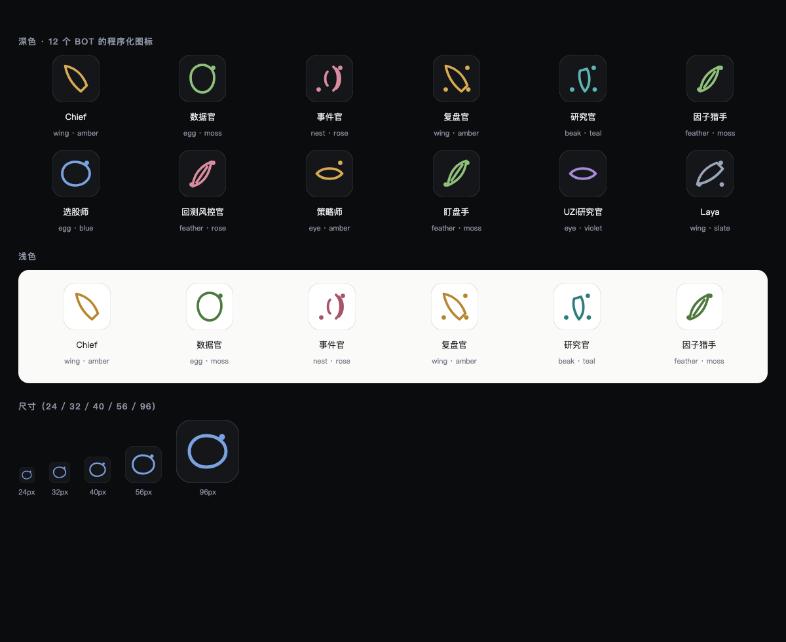

# @roost/identity

Bot 的确定性程序化图标：**同一个 id 永远同一个图标，零成本，不需要任何 API key。**

设计见 [`docs/design/bot-identity.md`](../../docs/design/bot-identity.md)。



## 怎么算

```
hash   = fnv1a(bot id)
family = hash % 6        → 蛋 / 羽 / 翼 / 眼 / 巢 / 喙
palette= hash/6 % 8      → 8 个强调色
rotate = hash/48 % 4     → 0/90/180/270
dots   = hash/192 % 4    → 装饰点 0..3
```

- 输出 **SVG**（< 500 bytes），任意尺寸不糊
- 深浅色各一套配色
- 改名**不**改形象（只认 id）

## 用法

```ts
import { glyphSvg, specFor } from '@roost/identity'
const svg = glyphSvg('selector', 'dark', 40)
```

## 与上传/AI 生成的关系

程序化图标是**默认与回落**；上传图片或 AI 生成是升级项（`bot-identity.md` §5）。图片不可用时仍显示程序化图标，不会出现灰方块。

## 待办

- [ ] 12 个族（当前 6 个，768 组合）
- [ ] 状态环（工作中/需要你/暂停）叠加在图标外围
- [ ] 群聊拼合（≤4 人 2×2 + N）
